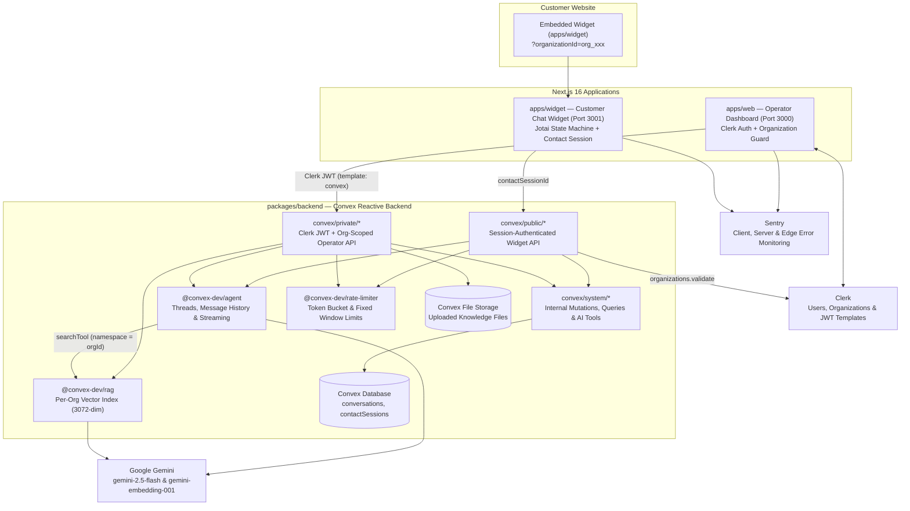

# Ventox — Multi-Tenant AI Customer Support Platform

Ventox is a B2B multi-tenant customer-support platform built with a Turborepo monorepo, Next.js 16, Convex, Clerk Organizations, and Google Gemini. Companies sign up in the **Operator Dashboard** (`apps/web`), upload knowledge-base documents (PDFs, images, HTML, text) into an organization-scoped vector index, and embed the **Customer Widget** (`apps/widget`) on their website. Website visitors chat in real time with a Retrieval-Augmented Generation (RAG) AI support agent that can automatically search organization documents, escalate complex issues to human operators, or mark resolved threads closed.

---

## Architecture Overview



---

## Monorepo Structure

```text
ventox/
├── apps/
│   ├── web/                          # Operator Dashboard (Next.js 16, port 3000)
│   │   ├── app/
│   │   │   ├── (auth)/               # Sign-in, Sign-up, Organization selection routes
│   │   │   └── (dashboard)/          # Overview, Conversations inbox, Knowledge files, Studio
│   │   ├── components/providers.tsx  # ConvexProviderWithAuth + Clerk JWT token bridge
│   │   ├── modules/
│   │   │   ├── auth/                 # AuthGuard, OrganizationGuard, branded auth views
│   │   │   ├── dashboard/            # Sidebar, ConversationPanel, live ConversationsView
│   │   │   └── files/                # FileView, UploadDialog, DeleteFileDialog
│   │   └── proxy.ts                  # Next.js 16 Clerk middleware & org-selection redirect
│   │
│   └── widget/                       # Embeddable Customer Widget (Next.js 16, port 3001)
│       ├── app/page.tsx              # Parses ?organizationId / ?orgId / ?orgID query params
│       └── modules/widget/
│           ├── atoms/widget-atoms.ts # Jotai screen state machine & per-org localStorage session
│           └── ui/
│               ├── views/            # WidgetView router & 30s session heartbeat
│               └── screens/          # Loading, Auth, Selection, Chat, Inbox, Error screens
│
├── packages/
│   ├── backend/                      # Convex Backend + AI Agent + RAG + Rate Limiter
│   │   └── convex/
│   │       ├── schema.ts             # conversations & contactSessions tables + indexes
│   │       ├── convex.config.ts      # Registers agent, rag, and rateLimiter components
│   │       ├── auth.config.ts        # Clerk JWT issuer verification
│   │       ├── public/               # Widget-callable endpoints (organizations, contactSessions, conversations, messages)
│   │       ├── private/              # Operator-callable endpoints (conversations, messages, files)
│   │       ├── system/               # Internal queries/mutations, supportAgent, RAG, AI tools
│   │       └── lib/                  # Multimodal text extraction & rateLimiter configuration
│   │
│   ├── ui/                           # Shared Design System (@workspace/ui)
│   │   └── src/
│   │       ├── components/           # 50+ shadcn/ui & Radix primitives + AI chat components
│   │       ├── hooks/                # useInfiniteScroll, useMobile
│   │       ├── lib/                  # cn(), assistant display helpers, country utilities
│   │       └── styles/globals.css    # Tailwind CSS v4 tokens, glassmorphic & ambient utilities
│   │
│   ├── eslint-config/                # Shared ESLint flat configs (base, next, react-internal)
│   └── typescript-config/            # Shared tsconfig presets (base, nextjs, react-library)
│
├── turbo.json                        # Turborepo task pipeline & strict environment allowlist
├── pnpm-workspace.yaml               # Workspace package declarations
└── package.json                      # Root scripts & engine constraints (Node >= 20, pnpm 10)
```

---

## Tech Stack & Why Each Technology Is Used

| Layer | Technology | Role in Ventox |
|---|---|---|
| **Monorepo & Build** | **pnpm Workspaces + Turborepo** | Links `@workspace/backend` and `@workspace/ui` across both Next.js apps with zero publish overhead and parallel cached builds. |
| **Frontend Framework** | **Next.js 16 (App Router) + React 19** | Powers both the operator dashboard (`apps/web`) and customer widget (`apps/widget`), using Next 16 `proxy.ts` middleware conventions. |
| **Backend & Realtime DB** | **Convex** | Provides end-to-end type-safe reactive queries (`useQuery`), transactional mutations (`useMutation`), external API actions (`useAction`), and file storage—eliminating manual WebSocket infrastructure. |
| **AI Agent Orchestration** | **`@convex-dev/agent` + Vercel AI SDK (`ai` v6)** | Manages persistent conversation threads, message history, streaming updates (`syncStreams`), and multi-step tool execution (`searchTool`, `escalateConversation`, `resolveConversation`). |
| **Knowledge Base (RAG)** | **`@convex-dev/rag`** | Chunks uploaded documents, embeds them with `gemini-embedding-001` (3072 dimensions), deduplicates via SHA-256 `contentHash`, and isolates vectors per tenant (`namespace = organizationId`). |
| **LLM & Multimodal AI** | **Google Gemini (`@ai-sdk/google`)** | `gemini-2.5-flash` powers the support agent and operator draft enhancer; `gemini-2.0-flash` extracts text from PDFs, images, and HTML; `gemini-embedding-001` powers vector search. |
| **Authentication & Multi-Tenancy** | **Clerk (`@clerk/nextjs`, `@clerk/backend`)** | Authenticates operators, enforces organization membership (`proxy.ts` + `OrganizationGuard`), and signs the `convex` JWT template containing `orgId`. |
| **Rate Limiting** | **`@convex-dev/rate-limiter`** | Enforces token-bucket and fixed-window rate limits on public widget messages, session creation, file uploads, and AI draft enhancement. |
| **Widget State Management** | **Jotai (`atomFamily`, `atomWithStorage`)** | Drives the widget screen state machine (`loading → auth → selection → chat / inbox`) and persists `contactSessionId` per organization in `localStorage`. |
| **Design System & Forms** | **Tailwind CSS v4 + shadcn/ui + Radix UI + React Hook Form + Zod** | Shared accessible UI primitives, AI chat components (`AIMessage`, `AIResponse`, `AIInput`), and schema-validated forms. |
| **Observability** | **Sentry (`@sentry/nextjs`)** | Captures client, server, and edge runtime exceptions with replay-on-error and configurable production trace sampling. |

---

## How the System Works End-to-End

### 1. Three-Layer Backend Security Model
All backend functions in `packages/backend/convex/` are strictly separated into three directories:

- **`convex/public/*` (Customer Widget API)**: Callable by the embedded widget without Clerk authentication. Every request must present a valid `contactSessionId`. The server verifies that the session exists, has not expired (24-hour TTL), and owns the target conversation (`conversation.contactSessionId === contactSession._id`).
- **`convex/private/*` (Operator Dashboard API)**: Callable only by signed-in operators with a valid Clerk JWT (`ctx.auth.getUserIdentity()`). Every query, mutation, and action extracts `identity.orgId` and scopes all database reads, writes, and RAG operations to that organization.
- **`convex/system/*` (Internal Backend Layer)**: Uses `internalQuery` and `internalMutation` so these functions can **only** be called by other Convex server functions or AI agent tools—never directly from a browser client.

### 2. Customer Widget Session & Conversation Flow
1. **Boot (`WidgetLoadingScreen`)**:
   - Reads the organization identifier from the URL (`?organizationId=org_...`, or shorthand `?orgId=` / `?orgID=`) or `NEXT_PUBLIC_DEFAULT_ORGANIZATION_ID`.
   - Calls `api.public.organizations.validate` (Convex action) which verifies the organization with Clerk.
   - Checks `localStorage` (`ventox_contact_session_<orgId>`) via Jotai's `atomWithStorage(..., { getOnInit: true })`.
   - If a stored `contactSessionId` exists and `api.public.contactSessions.validate` confirms it is unexpired, transitions directly to the **Selection** screen; otherwise transitions to **Auth**.
2. **Visitor Authentication (`WidgetAuthScreen`)**:
   - Visitor enters their name and email.
   - Calls `api.public.contactSessions.create`, which validates input, enforces the per-organization rate limit, records browser metadata (timezone, viewport, user agent, referrer), and creates a 24-hour `contactSessions` document.
3. **Starting & Conducting a Chat (`WidgetSelectionScreen` → `WidgetChatScreen`)**:
   - Clicking **Start chat** calls `api.public.conversations.create`, which creates an `@convex-dev/agent` thread, posts the initial greeting message, and inserts an `unresolved` conversation record.
   - When the visitor sends a message via `api.public.messages.create`:
     - If the conversation status is **`unresolved`**, `supportAgent` continues the thread with `gemini-2.5-flash` (`stopWhen: stepCountIs(5)`):
       - For product, pricing, policy, or how-to questions, the agent calls **`searchTool`**, which queries the organization's isolated RAG namespace (`rag.search(ctx, { namespace: conversation.organizationId, query, limit: 5 })`).
       - If the user asks for a person or is frustrated, the agent calls **`escalateConversationTool`**, flipping status to `escalated` and posting a handoff notice.
       - If the user confirms their issue is solved, the agent calls **`resolveConversationTool`**, flipping status to `resolved`.
     - If the conversation status is **`escalated`**, the visitor's message is saved directly to the thread without invoking the AI so the human operator can reply from the dashboard.

### 3. Operator Dashboard & Knowledge Base Flow
1. **Knowledge Base Ingestion (`private/files.ts`)**:
   - Operators upload PDFs, images, HTML, or text files from `/files`.
   - `private.files.addFile` checks the 10 MB size limit and rate limit, stores the blob in Convex Storage, extracts text via `extractTextContent.ts` (using Gemini multimodal transcription for PDFs, images, and HTML), and indexes the text into `@convex-dev/rag` under `namespace: orgId` with SHA-256 content-hash deduplication.
2. **Real-Time Inbox & Human Handoff (`private/conversations.ts` & `private/messages.ts`)**:
   - Operators filter conversations by `unresolved`, `escalated`, or `resolved`.
   - Sending a reply from the dashboard via `private.messages.create` automatically transitions the conversation to `escalated` (pausing AI auto-replies) and appends the operator's message to the shared thread. Both the dashboard and the customer widget update instantaneously via Convex reactive subscriptions.
   - Operators (and visitors) can click **Enhance** to polish draft replies with Gemini (`enhanceText.ts`).

---

## Local Development Setup

### 1. Prerequisites
- **Node.js** `>= 20`
- **pnpm** `10.4.1` (via `corepack enable`)
- A **Convex** project (https://dashboard.convex.dev)
- A **Clerk** application with **Organizations** enabled (https://dashboard.clerk.com)
- A **Google AI Studio** API key for Gemini (https://aistudio.google.com)

### 2. Install Dependencies
```bash
corepack pnpm install
```

### 3. Configure Clerk JWT Template for Convex
1. In your **Clerk Dashboard**, enable **Organizations**.
2. Go to **JWT Templates → New Template → Convex** and name it exactly **`convex`**.
3. Under **Claims**, add the `orgId` claim required by `packages/backend/convex/private/*`:
   ```json
   {
     "orgId": "{{org.id}}"
   }
   ```
4. Copy the **Issuer URL** (e.g., `https://<your-instance>.clerk.accounts.dev`).

### 4. Configure Environment Variables

**`apps/web/.env.local`** (copy from `apps/web/.env.example`):
```env
NEXT_PUBLIC_CONVEX_URL=https://<your-deployment>.convex.cloud
NEXT_PUBLIC_CLERK_PUBLISHABLE_KEY=pk_test_...
CLERK_SECRET_KEY=sk_test_...
NEXT_PUBLIC_CLERK_SIGN_IN_URL=/sign-in
NEXT_PUBLIC_CLERK_SIGN_UP_URL=/sign-up
NEXT_PUBLIC_SENTRY_DSN=
```

**`apps/widget/.env.local`** (copy from `apps/widget/.env.example`):
```env
NEXT_PUBLIC_CONVEX_URL=https://<your-deployment>.convex.cloud
NEXT_PUBLIC_DEFAULT_ORGANIZATION_ID=org_...
NEXT_PUBLIC_SENTRY_DSN=
```

**Convex Deployment Environment Variables** (in Convex Dashboard → **Settings → Environment Variables** or via CLI):
```bash
cd packages/backend
npx convex env set CLERK_JWT_ISSUER_DOMAIN "https://<your-instance>.clerk.accounts.dev"
npx convex env set CLERK_SECRET_KEY "sk_test_..."
npx convex env set GOOGLE_GENERATIVE_AI_API_KEY "AIza..."
```

### 5. Run the Monorepo
```bash
# Push Convex schema & functions (in packages/backend)
cd packages/backend && npx convex dev

# Start both Next.js apps from the repository root
corepack pnpm dev
```
- **Operator Dashboard**: `http://localhost:3000`
- **Customer Widget**: `http://localhost:3001/?organizationId=<your_clerk_org_id>`

---

## Verification & Production Deployment

```bash
# Typecheck all packages
corepack pnpm --filter web typecheck
corepack pnpm --filter widget typecheck

# Lint all workspace packages
corepack pnpm -r run lint

# Build production bundles
corepack pnpm -r run build
```

1. **Deploy Convex Backend to Production**:
   ```bash
   cd packages/backend
   npx convex env set CLERK_JWT_ISSUER_DOMAIN "https://clerk.<your-domain>" --prod
   npx convex env set CLERK_SECRET_KEY "sk_live_..." --prod
   npx convex env set GOOGLE_GENERATIVE_AI_API_KEY "..." --prod
   npx convex deploy
   ```
2. **Deploy `apps/web` and `apps/widget` to Vercel**:
   - Create two Vercel projects connected to this repository:
     - **`ventox-web`**: Root Directory = `apps/web`, env vars from `apps/web/.env.example`.
     - **`ventox-widget`**: Root Directory = `apps/widget`, env vars from `apps/widget/.env.example`.
